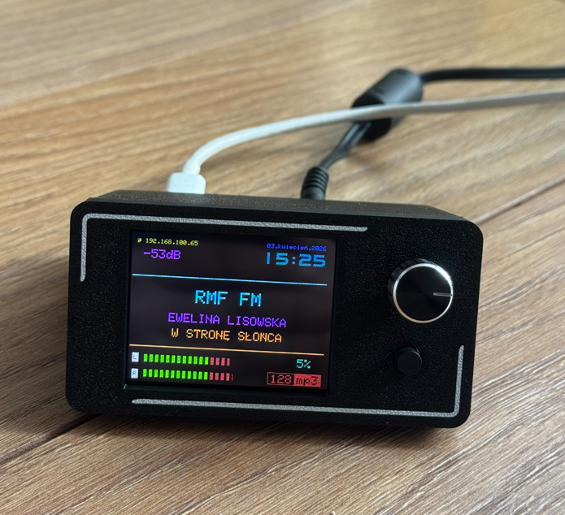

# 📻 yoRadio ESP32-S3 N16R8 | Wyświetlacz TFT 2,4" ST7789

**Zmodyfikowane oprogramowanie yoRadio | Wersja 2026.31.03 | Edycja polska**

Zmodyfikowana wersja otwartoźródłowego projektu [yoRadio autorstwa e2002](https://github.com/e2002/yoradio), przygotowana z myślą o mikrokontrolerze **ESP32-S3 N16R8** z **wyświetlaczem TFT 2,4 cala ST7789**, enkoderem obrotowym, dedykowanym przyciskiem uśpienia oraz przetwornikiem cyfrowo-analogowym PCM5102 wykorzystującym interfejs I2S.

Wersja ta zawiera usprawnienia interfejsu użytkownika, konfiguracji sprzętowej, obsługi automatycznej zmiany czasu letniego i zimowego oraz działania przycisków.

---

## ✨ Funkcje i wprowadzone ulepszenia

- **Automatyczna zmiana czasu letniego i zimowego (DST)** – Poprawiono mechanizm automatycznego przełączania między czasem letnim a zimowym.
- **Przycisk uśpienia** – Usprawniono działanie przycisku uśpienia w celu zapewnienia niezawodnej pracy.
- **Zmodyfikowany interfejs użytkownika** – Dostosowano układ interfejsu oraz kolorystykę.
- **Obsługa wyświetlacza TFT** – Zoptymalizowano konfigurację dla wyświetlacza ST7789 o przekątnej 2,4 cala.
- **Enkoder obrotowy** – Zintegrowano sterowanie umożliwiające nawigację po menu oraz regulację głośności.
- **Łączność Wi-Fi** – Obsługa sieci bezprzewodowych w paśmie 2,4 GHz.
- **Interfejs WWW** – Możliwość konfiguracji stacji radiowych oraz sterowania urządzeniem za pomocą przeglądarki internetowej.

## ⚙️ Wymagania sprzętowe

| Element | Specyfikacja |
|---|---|
| Mikrokontroler | ESP32-S3 N16R8 |
| Pamięć Flash | 16 MB |
| Pamięć PSRAM | 8 MB |
| Wyświetlacz | TFT 2,4" ST7789 (SPI) |
| Przetwornik audio DAC | PCM5102 (I2S) |
| Sterowanie | Enkoder obrotowy z przyciskiem |
| Sterowanie uśpieniem | Dedykowany przycisk |
| Łączność | Wi-Fi 2,4 GHz |
| Zasilanie | USB-C (płytka ESP32) |

## 🔌 Schemat połączeń i przypisanie pinów

Poniższa konfiguracja pinów została zastosowana w tej zmodyfikowanej wersji oprogramowania.

### Wyświetlacz TFT – ST7789 (2,4")

| Pin wyświetlacza | Pin ESP32-S3 | Funkcja |
|---|---|---|
| VCC | 3V3 | Zasilanie |
| GND | GND | Masa |
| SCL | GPIO 12 | Zegar SPI (SCK) |
| SDA | GPIO 11 | Dane SPI (MOSI) |
| RES | GPIO 38 | Reset wyświetlacza |
| DC | GPIO 9 | Dane / Komendy |
| CS | GPIO 10 | Wybór układu (Chip Select) |
| BLK | GPIO 14 | Sterowanie podświetleniem |

### Enkoder obrotowy

| Pin enkodera | Pin ESP32-S3 | Funkcja |
|---|---|---|
| A | GPIO 15 | Kanał A enkodera |
| B | GPIO 16 | Kanał B enkodera |
| PUSH | GPIO 17 | Przycisk enkodera |

### Przycisk uśpienia

| Pin przycisku | Pin ESP32-S3 | Funkcja |
|---|---|---|
| KO | GPIO 8 | Sterowanie trybem uśpienia |

### Przetwornik audio DAC – PCM5102 (I2S)

| Pin PCM5102 | Pin ESP32-S3 | Funkcja |
|---|---|---|
| VIN | 3V3 | Zasilanie |
| GND | GND | Masa |
| BCK | GPIO 4 | Zegar bitowy I2S |
| DIN | GPIO 5 | Dane audio I2S |
| LRCK | GPIO 6 | Sygnał wyboru kanału I2S |

**Uwaga:** Powyższe tabele przedstawiają połączenia zastosowane w konkretnej konfiguracji sprzętowej. Inne płytki ESP32 lub moduły wyświetlaczy mogą wymagać odmiennego przypisania pinów.

---

## 🚀 Instalacja oprogramowania

### 1. Wymagane oprogramowanie

Przed rozpoczęciem kompilacji należy zainstalować następujące oprogramowanie:

| Oprogramowanie | Wersja / Wymagania |
|---|---|
| Arduino IDE | **1.8.19 (Legacy)** |
| Pakiet płytek ESP32 | 2.0.0 lub nowszy, zgodny z oprogramowaniem |
| ESP32 Filesystem Uploader | Wymagany do przesyłania systemu plików metodą Arduino IDE |
| Sterownik USB | Zależny od zastosowanej płytki ESP32-S3 |

**Ważne:** Zgodnie z dokumentacją oryginalnego projektu yoRadio zalecane jest korzystanie z Arduino IDE 1.8.19. Wersja Arduino IDE 2.x nie jest oficjalnie obsługiwana przez oryginalną instrukcję instalacji.

### 2. Wymagane biblioteki Arduino

Zainstaluj następujące biblioteki za pomocą **Arduino IDE → Szkic → Dołącz bibliotekę → Zarządzaj bibliotekami**.

| Biblioteka | Zastosowanie |
|---|---|
| [Adafruit GFX Library](https://github.com/adafruit/Adafruit-GFX-Library) | Obsługa grafiki i wyświetlania tekstu |
| [Adafruit ST7735 and ST7789 Library](https://github.com/adafruit/Adafruit-ST7735-Library) | Sterownik wyświetlacza TFT |
| [OneButton](https://github.com/mathertel/OneButton) | Obsługa przycisków, jeżeli biblioteka nie jest już dołączona do projektu |

Niektóre zależności są już zawarte w nowszych wersjach yoRadio. W zależności od wybranej konfiguracji sprzętowej i aktywowanych funkcji mogą być wymagane dodatkowe biblioteki.

Więcej informacji znajduje się w [dokumentacji zależności oryginalnego projektu yoRadio](https://github.com/e2002/yoradio#dependencies).

### 3. Pobieranie oprogramowania

Pobierz repozytorium, wybierając **Code → Download ZIP** na stronie GitHub, lub sklonuj je za pomocą Git.

Rozpakuj pobrane pliki do wybranego katalogu na komputerze.

### 4. Konfiguracja oprogramowania

1. Otwórz plik `yoRadio.ino` w środowisku Arduino IDE.
2. Wybierz odpowiednią płytkę ESP32-S3 w menu **Narzędzia → Płytka**.
3. Otwórz plik `myoptions.h`.
4. Sprawdź konfigurację pinów wyświetlacza, enkodera, przetwornika DAC oraz przycisków.
5. Dostosuj ustawienia do zastosowanej konfiguracji sprzętowej.

**Ważne:** Wszelkie zmiany konfiguracji należy wprowadzać w pliku `myoptions.h`, zamiast edytować oryginalny plik `options.h`.

Jeżeli wyświetlacz wymaga niestandardowych symboli czcionek yoRadio, należy postępować zgodnie z oryginalną instrukcją i zastąpić plik `Adafruit_GFX_Library/glcdfont.c` plikiem `yoRadio/fonts/glcdfont.c`.

### 5. Wgrywanie danych systemu plików

Zainstaluj narzędzie [ESP32 Filesystem Uploader](https://randomnerdtutorials.com/install-esp32-filesystem-uploader-arduino-ide/), jeżeli korzystasz z klasycznej metody przesyłania danych przez Arduino IDE.

*Źródło ilustracji: [e2002/yoradio](https://github.com/e2002/yoradio). Przykładowa konfiguracja Arduino IDE przedstawiona w oryginalnym projekcie.*

W środowisku Arduino IDE:

1. Podłącz ESP32-S3 do komputera.
2. Wybierz odpowiedni port COM.
3. Wybierz **Narzędzia → ESP32 Sketch Data Upload**.
4. Prześlij dane systemu plików do pamięci mikrokontrolera.

**Uwaga:** Nowsze wersje oryginalnego projektu yoRadio udostępniają również narzędzie Web Board Uploader, które może być wykorzystywane zamiast klasycznego narzędzia przesyłania systemu plików.

### 6. Wgrywanie oprogramowania

1. Sprawdź poprawność ustawień płytki ESP32-S3.
2. Skompiluj projekt.
3. Wybierz **Szkic → Wgraj**.
4. Po zakończeniu przesyłania oprogramowania uruchom ponownie ESP32-S3.

### 7. Pierwsze uruchomienie i konfiguracja Wi-Fi

Domyślnie oryginalne oprogramowanie yoRadio uruchamia własny punkt dostępowy Wi-Fi, jeżeli urządzenie nie ma zapisanej konfiguracji sieci bezprzewodowej.

- **Nazwa sieci Wi-Fi (SSID):** `yoRadioAP`
- **Domyślne hasło:** `12345987`
- **Adres panelu konfiguracji:** `http://192.168.4.1`

Połącz się z utworzonym punktem dostępowym i skonfiguruj połączenie z domową siecią Wi-Fi.

Po nawiązaniu połączenia z siecią otwórz lokalny adres IP urządzenia w przeglądarce internetowej, aby uzyskać dostęp do interfejsu yoRadio i skonfigurować stacje radiowe.

Więcej informacji znajduje się w [oficjalnej instrukcji instalacji yoRadio](https://github.com/e2002/yoradio/wiki/How-to-flash).

---

## 📸 Galeria projektu

W tej sekcji zostaną zamieszczone zdjęcia urządzenia zbudowanego na podstawie ESP32-S3 oraz jego interfejsu wyświetlanego na ekranie TFT.

Przykładowe zdjęcia oryginalnego projektu można znaleźć w [oficjalnej galerii yoRadio](https://github.com/e2002/yoradio/blob/main/Images.md).

## 🔗 Przydatne odnośniki

- [Oryginalne repozytorium yoRadio](https://github.com/e2002/yoradio)
- [Oficjalna Wiki yoRadio](https://github.com/e2002/yoradio/wiki)
- [Instrukcja instalacji yoRadio](https://github.com/e2002/yoradio/wiki/How-to-flash)
- [Generator konfiguracji sprzętowej yoRadio](https://e2002.github.io/docs/myoptions-generator.html)
- [Arduino IDE 1.8.19](https://www.arduino.cc/en/software)
- [ESP32 Arduino Core](https://github.com/espressif/arduino-esp32)

---

## 📜 Autorzy i licencja

Projekt powstał na podstawie oryginalnego oprogramowania **[yoRadio autorstwa e2002](https://github.com/e2002/yoradio)**.

Szczególne podziękowania należą się **e2002** oraz wszystkim osobom zaangażowanym w rozwój i utrzymanie oryginalnego projektu yoRadio.

Niniejsze repozytorium zawiera nieoficjalną, zmodyfikowaną wersję oprogramowania, dostosowaną do określonej konfiguracji sprzętowej ESP32-S3.

Oryginalny projekt yoRadio jest udostępniany na licencji **GNU General Public License v3.0 (GPL-3.0)**.

Niniejsza zmodyfikowana wersja oprogramowania jest rozpowszechniana na warunkach tej samej licencji GPL-3.0. Należy zachować oryginalne informacje o prawach autorskich oraz przestrzegać warunków licencyjnych.

Pełne informacje dotyczące licencji znajdują się w [oryginalnym pliku licencji yoRadio](https://github.com/e2002/yoradio/blob/main/LICENSE).

---

**Na podstawie yoRadio • Dostosowane do ESP32-S3 N16R8 • Wersja 2026.31.03**
